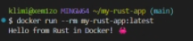

# my-rust-app

Учебный проект с CI на GitHub Actions для Rust-приложения.

## 📌 Цель работы

Настроить CI для Rust-проекта: линтинг, форматирование, сборка, тесты, сборка Docker-образа.

## 🎯 Что делает CI

Три job'а:

1. **Lint & Format** — `cargo fmt --check` + `cargo clippy -D warnings`
2. **Build & Test** — `cargo check`, `build`, `build --release`, `test`
3. **Build Docker Image** — сборка образа + артефакт + тестовый запуск

## 📂 Структура проекта

```
my-rust-app/
├── .github/workflows/rust-ci.yml
├── src/main.rs
├── Cargo.toml
├── Cargo.lock
├── Dockerfile
├── .dockerignore
├── .gitignore
└── README.md
```

## 🦀 Основной код

```rust
use std::io::{self, Write};

fn main() {
    println!("Hello from Rust in Docker! 🦀");
    io::stdout().flush().unwrap();
    std::thread::sleep(std::time::Duration::from_millis(200));
}
```

## 🚀 Запуск локально

```bash
docker build -t my-rust-app:latest .
docker images | grep my-rust-app
docker run --rm my-rust-app:latest
```

Ожидаемый вывод:
```
Hello from Rust in Docker! 🦀
```

## 📸 Результат запуска



## ✅ Результат

При каждом push в `main` запускается CI.
На вкладке **Actions** — 🟢 зелёные галочки.

**Ссылка на Actions:**  
https://github.com/xem1zo/my-rust-app/actions

## 📝 Вывод

Освоил настройку CI для Rust, работу с `dtolnay/rust-toolchain`, `cargo fmt`/`clippy`, multi-stage Docker, кэширование через `type=gha`.